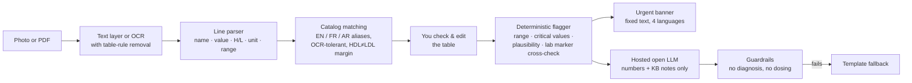

# 🔬 LabLens
**[▶ Try the live demo](https://huggingface.co/spaces/Imene-ee/LabLens)**
**Snap a photo of your blood test and understand it in plain language — in English, French, Arabic or Tunisian Darija.**

Millions of people receive lab results they can't read. Across North Africa that usually means waiting days for an appointment, or searching online in a language you only half understand. LabLens reads the report, flags what is out of range using fixed medical rules, explains each result calmly, and prepares the questions to ask your doctor. It never diagnoses.

## How it works



## Design decisions

**The LLM never decides what is abnormal or urgent.** Flags come from `lablens/flagger.py`, a few dozen lines of plain rules you can read in two minutes:

0. Physically impossible values (a dropped decimal: HbA1c 436%) become **CHECK**: never "normal", never an alarm.
1. Critical values (e.g. potassium > 6.2 mmol/L) trigger an urgent banner, after unit conversion (French labs report glucose in g/L, white cells in G/L).
2. Otherwise, the report's own reference range decides low/high.
3. No printed range → generic adult range, labelled as such.
4. Unknown unit → no critical escalation (we can't be sure), printed range only.
5. If the lab printed an **H/L marker that contradicts** the numbers we read, the result becomes CHECK. A misread value must never come out reassuring.

**Privacy by construction.** The hosted model only receives test names, values, units, ranges and flags. The image, patient name, lab and dates never leave the extraction step.

**Human in the loop.** OCR misreads digits. Instead of hiding that, LabLens shows exactly what it read in an editable table before explaining anything.

**Guardrails with a safe fallback.** Model output is parsed as JSON, unknown tests are dropped, and any diagnosis or dosing language ("you have diabetes", "take 1000 mg") swaps in a deterministic explanation from the knowledge base.

## Benchmark

There is no public benchmark of multilingual lab reports, so LabLens ships a generator for one: realistic English and French reports (three layouts, decimal commas, `g/L` vs `mg/dL`, `< 2,00` / `[4,00 – 5,60]` range styles, optional H/L markers), each rendered as a clean PDF and as a degraded "phone photo" (rotation, blur, low contrast, grain), with ground-truth JSON. All patients and labs are fictional.

Results on a held-out set of **200 reports (seeds 2000–2199)** that was not used during development:

| split | reports | rows | recall | precision | value_acc | unit_acc | range_acc | flag_acc | critical_recall | dangerous_misses |
|---|---|---|---|---|---|---|---|---|---|---|
| pdf/all | 200 | 1989 | 100.0% | 100.0% | 100.0% | 100.0% | 100.0% | 100.0% | 100.0% | 0 |
| pdf/en | 101 | 1009 | 100.0% | 100.0% | 100.0% | 100.0% | 100.0% | 100.0% | 100.0% | 0 |
| pdf/fr | 99 | 980 | 100.0% | 100.0% | 100.0% | 100.0% | 100.0% | 100.0% | 100.0% | 0 |
| photo/all | 200 | 1989 | 93.2% | 100.0% | 96.0% | 97.1% | 96.9% | 89.2% | 84.8% | 2 |
| photo/en | 101 | 1009 | 92.2% | 100.0% | 96.2% | 98.0% | 97.5% | 88.5% | 88.0% | 1 |
| photo/fr | 99 | 980 | 94.2% | 100.0% | 95.7% | 96.2% | 96.2% | 90.0% | 82.3% | 1 |

- **recall / precision**: rows found / rows extracted that are real
- **flag_acc**: end-to-end status equals ground truth (missed rows count as wrong)
- **critical_recall**: critical values that triggered the urgent path
- **dangerous_misses**: abnormal results shown as *normal* — the number that matters most

PDFs with a text layer are read perfectly. Photos are the hard part. Of the 59 critical values in the photo set, 50 triggered the urgent banner, 4 were shown as "please check this value", 2 rows were not read at all (visible as missing in the review table), 1 could not be judged and 1 was shown as high/low rather than critical. One critical value and one other abnormal value came out as *normal* (OCR misread a digit, and the lab printed no H/L marker to cross-check against). Across all ~590 abnormal photo rows, that is 2 false reassurances: the number this project exists to push to zero. It is why the review table exists, and why a vision model is next on the roadmap.

Reproduce:

```bash
python -m lablens.synth.generator --out benchmark/reports -n 200 --seed 2000
python -m lablens.evaluate --bench benchmark/reports
```

## Run locally

```bash
sudo apt-get install tesseract-ocr tesseract-ocr-fra tesseract-ocr-ara poppler-utils
pip install -r requirements.txt
export HF_TOKEN=hf_...            # optional: enables AI explanations
python app.py                      # http://127.0.0.1:7860
pytest -q                          # 47 tests, no network needed
```

Without a token the app still works and uses the knowledge-base templates.

| Variable | Default | Purpose |
|---|---|---|
| `HF_TOKEN` or `LLM_API_KEY` | – | Key for any OpenAI-compatible endpoint |
| `LLM_BASE_URL` | `https://router.huggingface.co/v1` | Hugging Face Inference Providers router |
| `LLM_MODEL` | `Qwen/Qwen2.5-72B-Instruct` | Open model used for explanations |

## Deploy to Hugging Face Spaces

1. Create a new Space (SDK: Gradio) and push this repo to it. `packages.txt` installs Tesseract and Poppler.
2. In the Space settings, add `HF_TOKEN` as a secret (a fine-grained token with Inference Providers permission).

## Project layout

```
lablens/
  data/catalog.yaml     23 tests: aliases (en/fr/ar), units, ranges, critical & plausible bounds, KB notes
  catalog.py            name + unit resolution, OCR-tolerant fuzzy matching
  extract.py            PDF text / OCR (OpenCV clean-up) -> structured rows
  flagger.py            deterministic flags and urgent escalation
  explain.py            hosted LLM + guardrails + template fallback
  i18n.py               fixed safety text in EN / FR / AR / Darija
  synth/generator.py    synthetic benchmark generator
  evaluate.py           benchmark metrics
app.py                  Gradio app
tests/                  safety-critical unit tests
```

## Roadmap

- [ ] Vision-language model for photo extraction, compared head-to-head with OCR on this benchmark
- [ ] Arabic-language report layouts in the generator
- [ ] Knowledge base expanded from MedlinePlus (public domain) with retrieval
- [ ] Explanation-quality eval: faithfulness to KB notes, Darija fluency rated by native speakers
- [ ] On-device mode (in-browser model) so nothing leaves the phone
- [ ] Publish the benchmark as a Hugging Face dataset

## Disclaimer

LabLens is an educational project. It explains lab results in plain language; it does not diagnose and does not replace a doctor. Critical thresholds are conservative values from commonly published hospital lists and every lab sets its own.

Built by [Imene Guizani](https://linkedin.com/in/imene-guizani). MIT licensed.
